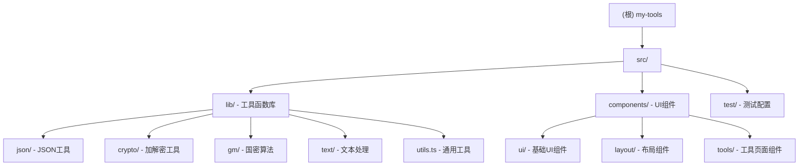

# 开发者工具应用 (Developer Tools)

> 最后更新：2026-02-28 17:46:07

## 项目愿景

一个基于 TDD (测试驱动开发) 方法论构建的现代化开发者工具集合，采用纯前端实现保护用户隐私。提供 JSON 格式化、加解密、国密算法、文本处理等实用工具，遵循 SOLID、KISS、DRY、YAGNI 设计原则。

## 架构总览

**技术栈：**
- **前端框架：** React 19 + TypeScript
- **构建工具：** Vite 8.x
- **UI 组件：** Tailwind CSS 4（@tailwindcss/vite 插件）+ 自定义组件（参考 shadcn/ui 设计）
- **路由：** React Router DOM v7
- **测试框架：** Vitest 5 + React Testing Library 16
- **加密库：** crypto-js、js-base64、sm-crypto

**开发模式：**
- 严格遵循 **RED → GREEN → REFACTOR** TDD 循环
- 目标测试覆盖率：80%+
- 所有数据处理在本地进行，不发送任何数据到服务器

## 模块结构图



## 模块索引

| 模块路径 | 职责 | 测试覆盖 | 状态 |
|---------|------|---------|------|
| [src/lib/json](./src/lib/json/CLAUDE.md) | JSON 格式化、验证、压缩、自动修复 | 89.62% | ✅ 完成 |
| [src/lib/crypto](./src/lib/crypto/CLAUDE.md) | Base64、哈希、AES 加解密 | 77.95% | ✅ 完成 |
| [src/lib/gm](./src/lib/gm/CLAUDE.md) | 国密 SM2/SM3/SM4 算法 | 有测试 | ✅ 完成 |
| [src/lib/text](./src/lib/text/CLAUDE.md) | 文本大小写、去重、统计 | 42 个测试 | ✅ 完成 |
| [src/lib/cron](./src/lib/cron/) | Cron 解析、验证、解释、调度 | 40 个测试 | ✅ 完成 |
| [src/lib/jwt](./src/lib/jwt/) | JWT 生成、解析、验证 | 20 个测试 | ✅ 完成 |
| [src/lib/qrcode](./src/lib/qrcode/) | 二维码生成、下载 | 有测试 | ✅ 完成 |
| [src/lib/regex](./src/lib/regex/) | 正则测试、模板、代码生成 | 有测试 | ✅ 完成 |
| [src/lib/time](./src/lib/time/) | 时间戳转换、日期计算 | 有测试 | ✅ 完成 |
| [src/lib/idCard](./src/lib/idCard/) | 身份证生成、验证 | 有测试 | ✅ 完成 |
| [src/lib/ai](./src/lib/ai/) | AI 流式客户端（OpenAI 兼容）、SSE 解析、设置存储 | 有测试 | ✅ 完成 |
| [src/lib/exception](./src/lib/exception/) | Java 异常堆栈解析（异常链、根因、包统计、业务帧定位） | 14 个测试 | ✅ 完成 |
| [src/lib/utils.ts](./src/lib/CLAUDE.md) | 通用工具函数 | 100% | ✅ 完成 |
| [src/components](./src/components/CLAUDE.md) | UI 组件和页面组件 | - | ✅ 完成 |

## 运行与开发

### 开发命令

```bash
# 安装依赖
npm install

# 开发模式（热更新）
npm run dev

# 构建生产版本
npm run build

# 预览构建结果
npm run preview
```

### 测试命令

```bash
# 运行所有测试
npm test

# 测试 UI 界面
npm run test:ui

# 生成覆盖率报告
npm run test:coverage
```

### 代码质量

```bash
# ESLint 检查
npm run lint

# Prettier 格式化
npm run format
```

## 测试策略

### 测试框架配置
- **Vitest** 作为测试运行器
- **React Testing Library** 用于组件测试
- **jsdom** 模拟浏览器环境
- **@vitest/coverage-v8** 提供覆盖率报告

### 测试结构
```
src/
├── lib/
│   ├── json/
│   │   ├── index.ts
│   │   ├── json.test.ts        # 单元测试
│   │   └── types.ts
│   ├── crypto/
│   │   ├── index.ts
│   │   ├── crypto.test.ts      # 单元测试
│   │   └── types.ts
│   └── utils.ts
│   └── utils.test.ts           # 单元测试
└── test/
    └── setup.ts                # 测试全局配置
```

### 当前测试覆盖情况

> 注：`npm run test:coverage` 当前配置会统计项目内全部文件，结果仅供参考；以下为各模块测试数量（2026-10-22 统计，共 27 个测试文件 / 324 个用例）。

| 模块 | 测试数量 |
|------|---------|
| text/ | 42 |
| cron/ | 40 |
| gm/ | 27 |
| crypto/ | 25 |
| jwt/ | 20 |
| json/ | 18 |
| qrcode/ | 9 |
| time/ | 22 |
| regex/ | 19 |
| idCard/ | 15 |
| utils.ts | 5 |
| ai/ | 39 |
| components/ui | 14 |

### TDD 开发流程

1. **RED** - 先编写失败的测试用例
2. **GREEN** - 实现最小代码使测试通过
3. **REFACTOR** - 重构改进代码质量
4. **覆盖** - 确保达到 80%+ 测试覆盖率

## 编码规范

### TypeScript 规范
- 使用严格模式：`strict: true`
- 优先使用 `interface` 定义对象类型
- 使用类型别名定义联合类型
- 避免使用 `any`，优先使用 `unknown`

### 命名规范
- **文件名：** camelCase（组件 PascalCase）
- **变量/函数：** camelCase
- **类型/接口：** PascalCase
- **常量：** UPPER_SNAKE_CASE
- **测试文件：** `*.test.ts` 或 `*.spec.ts`

### 组件规范
- 函数式组件 + Hooks
- 使用 TypeScript 定义 Props 类型
- 组件文件大写 PascalCase（如 `JsonFormatter.tsx`）

### 导入顺序
1. React 相关
2. 第三方库
3. 绝对路径导入（@/ 别名）
4. 相对路径导入
5. 类型导入（如有）

```typescript
import { useState } from 'react'
import { Link } from 'react-router-dom'
import { Card } from '@/components/ui/Card'
import { formatJson } from '@/lib/json'
import { LocalComponent } from './LocalComponent'
```

## AI 使用指引

### 开发新功能时的提示词模板

**1. 添加新工具函数（TDD 流程）**
```
请遵循 TDD 流程为 src/lib/[module]/ 添加 [功能名称]：
1. 先编写测试用例（RED）
2. 实现功能代码（GREEN）
3. 重构优化代码（REFACTOR）
4. 确保覆盖率达到 80%+

功能需求：
- [具体需求描述]
- [输入输出示例]
```

**2. 创建新工具页面组件**
```
请创建新工具页面组件 src/components/tools/[ToolName].tsx：
- 使用现有的 UI 组件（Card, Button, Textarea 等）
- 复用 JsonFormatter.tsx 的布局结构
- 集成 src/lib/[module]/ 的工具函数
- 添加错误处理和用户反馈
- 路由路径：/[path]
```

**3. 运行测试并修复**
```
请运行 npm test 并：
1. 查看失败的测试用例
2. 修复代码使测试通过
3. 运行 npm run test:coverage 检查覆盖率
4. 如果覆盖率 < 80%，补充测试用例
```

### 关键设计原则

**SOLID 原则：**
- **S**ingle Responsibility：每个函数/组件只做一件事
- **O**pen/Closed：通过函数组合扩展功能，而非修改现有代码
- **L**iskov Substitution：子类型可替换父类型
- **I**nterface Segregation：接口专一，不强制依赖不需要的方法
- **D**ependency Inversion：依赖抽象而非具体实现

**其他原则：**
- **KISS：** 保持简单直接
- **DRY：** 避免代码重复，提取公共逻辑
- **YAGNI：** 只实现当前需要的功能

### 代码审查检查清单

- [ ] 是否有对应的测试用例？
- [ ] 测试覆盖率是否达到 80%+？
- [ ] 是否遵循 TypeScript 严格模式？
- [ ] 是否处理了错误情况？
- [ ] 是否使用了正确的类型定义？
- [ ] 是否遵循命名规范？
- [ ] 是否有必要的注释说明复杂逻辑？
- [ ] 是否通过了 `npm run lint` 检查？

## 项目结构

```
my-tools/
├── src/
│   ├── lib/                    # 工具函数库（核心业务逻辑）
│   │   ├── json/               # JSON 工具
│   │   ├── crypto/             # 加解密工具
│   │   ├── gm/                 # 国密算法
│   │   ├── text/               # 文本处理工具
│   │   └── utils.ts            # 通用工具函数
│   ├── components/             # React 组件
│   │   ├── ui/                 # 基础 UI 组件
│   │   ├── layout/             # 布局组件
│   │   └── tools/              # 工具页面组件
│   ├── test/                   # 测试配置
│   ├── App.tsx                 # 应用入口
│   └── main.tsx                # React 挂载
├── public/                     # 静态资源
├── coverage/                   # 测试覆盖率报告
├── package.json                # 项目配置
├── vite.config.ts              # Vite 配置
├── tsconfig.json               # TypeScript 配置
├── tailwind.config.js          # Tailwind 配置
├── IMPLEMENTATION_PLAN.md      # 实施计划
└── README.md                   # 项目说明
```

## 路由结构

| 路径 | 组件 | 说明 |
|------|------|------|
| `/` | `Home` | 工具导航首页 |
| `/json` | `JsonFormatter` | JSON 格式化工具 |
| `/crypto` | `CryptoTools` | 加解密工具（Base64/哈希/AES/国密） |
| `/cron` | `CronTools` | Cron 表达式工具 |
| `/jwt` | `JwtTool` | JWT 工具 |
| `/idcard` | `IdCardTool` | 身份证工具 |
| `/time` | `TimeTool` | 时间戳工具 |
| `/qrcode` | `QRCodeTool` | 二维码工具 |
| `/regex` | `RegexTool` | 正则表达式工具（含 AI 生成） |
| `/exception` | `ExceptionAnalyzer` | 异常分析（堆栈本地解析 + AI 根因分析） |
| `/ai` | `AiSettings` | AI 设置（多档案 OpenAI 兼容接口配置） |
| `/ai-chat` | `AiChatNav` | AI 对话入口（桌面端 WebviewWindow 应用内窗口打开） |

> 所有工具页面组件均通过 `React.lazy` 按路由懒加载（见 `src/App.tsx`）。

## 常见问题

### Q: 如何添加新的工具模块？

1. 在 `src/lib/` 下创建新目录（如 `src/lib/encoder/`）
2. 编写工具函数（`index.ts`）和类型定义（`types.ts`）
3. 先编写测试文件（`*.test.ts`），遵循 TDD 流程
4. 在 `src/components/tools/` 创建对应的 UI 组件
5. 在 `src/App.tsx` 添加路由

### Q: 测试失败时如何调试？

```bash
# 运行特定测试文件
npm test -- json.test.ts

# 运行测试 UI（可视化调试）
npm run test:ui

# 查看覆盖率详情
npm run test:coverage
# 然后打开 coverage/index.html
```

### Q: 如何查看代码覆盖率？

运行 `npm run test:coverage` 后，查看：
- 终端输出的文本报告
- `coverage/index.html`（可视化 HTML 报告）

### Q: 国密算法的使用限制？

国密算法（SM2/SM3/SM4）仅供学习使用：
- SM2：椭圆曲线公钥密码（签名、加密）
- SM3：密码杂凑算法
- SM4：分组密码算法

密钥格式要求：
- SM2 公钥：64 字符十六进制字符串（不含前缀）
- SM2 私钥：64 字符十六进制字符串
- SM4 密钥：32 字符十六进制字符串（128 位）

## 变更记录

### 2026-10-22
- 新增一级入口「AI 对话」（/ai-chat，与网站导航并列）：14 个常用 AI 聊天入口（DeepSeek/Kimi/豆包/通义/文心/元宝/智谱/秘塔/ChatGPT/Claude/Gemini/Grok/Perplexity/Poe）；桌面端点击用 @tauri-apps/api 的 WebviewWindow 在应用内独立窗口打开（重复点击聚焦已有窗口），浏览器环境回退新标签页；capability 新增 core:webview:allow-create-webview-window 与 core:window:allow-set-focus（需重启 tauri dev 生效）
- 新增全局「问 AI」对话框（顶栏 ✨ 按钮或 Ctrl/Cmd+Shift+K）：src/lib/ai/toolContext.ts 上下文注册表（useToolAiContext hook，每次渲染重注册、卸载清除，超 4000 字符截断），正则/JSON/Cron/异常分析/SQL 五个工具页已注册上下文，提问时可勾选是否附带；buildAskMessages 构造带上下文的消息
- JsonFormatter 新增「AI 生成 Mock 数据」：以输入 JSON 为结构样例批量生成模拟数据（可加数量/取值约束），结果自动剥代码块并格式化；buildMockDataMessages 提示词约束字段名/结构一致、数据逼真、ID 唯一
- 新增 SQL 助手（/sql，导航「AI 助手」分组）：两种模式——DDL+自然语言需求生成 SQL、SQL（可含 EXPLAIN）优化分析；方言可选 MySQL/PostgreSQL/Oracle；buildSqlMessages 提示词按「SQL→逻辑说明→索引提示」/「问题分析→优化 SQL→优化点」结构约束输出
- CronTools 新增「AI 生成」：自然语言描述 → cron 表达式（可选 6 段 Quartz/Spring 或 5 段 crontab），流式生成后自动填入并用本地 validate 把关；lib/ai 新增 buildCronMessages 与 extractCronFromResponse（剥代码块/引号/前缀）
- 新增异常分析工具（/exception，导航「AI 助手」分组）：本地解析 src/lib/exception/（逐行解析异常链/Caused by/省略帧/包统计，业务包前缀定位最深业务帧，14 个测试）；AI 分析按「根因判断→触发场景→排查步骤→修复建议」结构流式输出（buildExceptionMessages），支持补充上下文与中断
- AI 设置升级为多配置档案（store 存 my-tools.ai.profiles）：新建/删除/重命名/切换档案，旧版单配置自动迁移为「默认」档案；loadAiSettings/saveAiSettings 语义改为指向激活档案，工具页无需改动
- JsonFormatter 新增「AI 生成 Java 实体」：JSON → Java 类（可选包名、Lombok @Data），流式输出 + 代码块清洗 + 一键复制；lib/ai 新增 buildJavaEntityMessages 与通用 extractCodeBlock（extractRegexFromResponse 复用）
- 新增 AI 能力基础模块 src/lib/ai/：OpenAI 兼容流式客户端（SSE 增量解析、可注入 fetch 便于测试）、设置存取（localStorage，默认 Ollama 端点 http://localhost:11434/v1）、AiError 错误分类（config/network/http/parse/aborted）
- 新增 AI 设置页（/ai，导航分组「AI 助手」）：BYOK 模式配置接口地址/API Key/模型名，测试连接并拉取模型列表，配置仅存本机
- RegexTool 接入「AI 生成正则」：自然语言描述流式生成正则并自动填入，支持中断；提示词与结果提取在 lib/ai/prompts.ts（含测试）
- tauri.conf.json 的 connect-src CSP 放宽为允许 http://localhost:*、http://127.0.0.1:* 与 https:，否则桌面版无法调用本地/云端 AI 接口
- 界面布局改为左侧菜单栏 + 右侧操作区：新增 Sidebar（可折叠侧边栏，导航为「开发工具 → 分组 → 工具」三级可折叠结构，当前项高亮，折叠状态持久化到 localStorage，路由切换时自动展开活动项所在分组，隐藏滚动条但保留滚动），删除顶部 Header/Footer
- 右侧操作区顶部新增 TopBar：Ctrl/Cmd+K 聚焦的工具搜索（下拉结果支持 ↑↓ 选择、回车打开）、已打开工具的标签页（自动记录、可关闭、持久化 localStorage、关闭当前页时激活相邻标签、+ 按钮回首页）
- 工具导航配置抽取为 layout/nav.ts 单一数据源，侧边栏与首页卡片共用
- 修复 JsonFormatter 全屏 ESC 键监听写在 return 之后导致功能失效的 bug
- 修复 RegexTool 非全局正则 exec 死循环、Java 代码生成标志映射错位的 bug
- 清理全部 ESLint 错误（any、@ts-ignore、prefer-const、Toast 导出拆分）
- 移除未使用依赖 zustand、date-fns；@types/qrcode 移至 devDependencies
- 清理垃圾文件（regionData.ts.backup、gm.example.ts、空目录 lib/m）
- 工具页面改为 React.lazy 路由级代码分割，主包 461KB → 205KB
- 新增 CI workflow（lint + test + build）；release workflow 改用 npm ci、Rust 缓存、版本同步抽为复合 action
- tauri.conf.json 设置基础 CSP，版本号与 package.json 同步
- 补齐 qrcode/regex/time/idCard 四个模块的单元测试（65 个新用例）
- 更新模块索引与路由表

### 2026-02-28 17:46:07
- 初始化 AI 上下文文档
- 生成根级和模块级 CLAUDE.md
- 创建 Mermaid 模块结构图
- 记录项目架构、测试策略、编码规范
- 文档覆盖率：100%（所有核心模块已记录）
